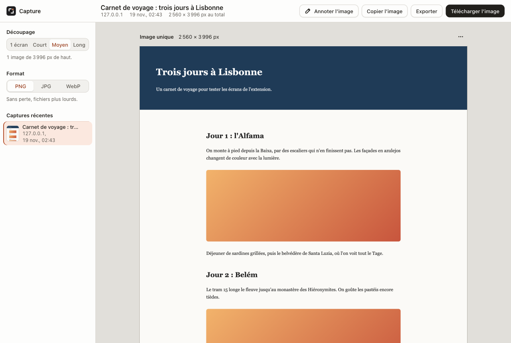
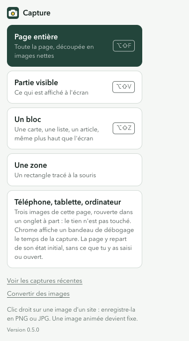
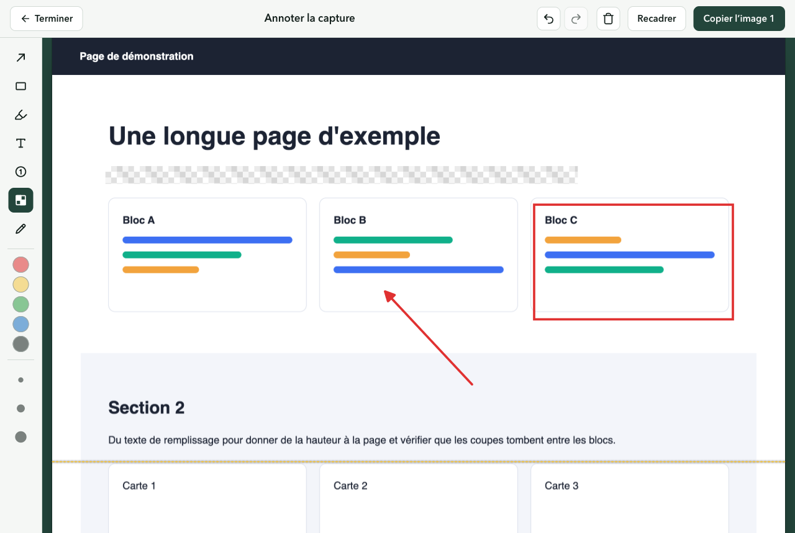
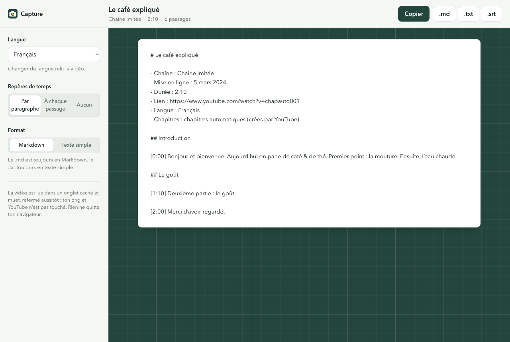

# Capture

A Chrome extension that captures a full web page in high resolution and splits it into sharp images, then lets you annotate or export them. It also converts images and turns a YouTube video into a structured transcript. No server, no account.

*The extension's interface is in French.*



## What it does

- **Capture**: the full page, the visible part, a block (even one taller than the screen) or an area drawn with the mouse. Shortcuts: `Alt+Shift+F`, `Alt+Shift+V`, `Alt+Shift+Z`.
- **See a page on three screens**: phone, tablet and desktop in a single action, in a separate tab.
- **Slice and export**: four slice lengths, in PNG, JPG or WebP, with export to a single PDF or a single zip.
- **Annotate**: arrow, rectangle, highlighter, text, numbered marker, masking, freehand pen and cropping. The original stays untouched. A masked area becomes a mosaic in which no pixel depends on the hidden content: only its size and position remain visible.
- **Convert images**: HEIC, PNG, JPG, WebP, AVIF, GIF and BMP in; JPG, PNG, WebP or a single PDF out. Images can be dropped or pasted.
- **Save an image from a website**: right-click, then PNG or JPG.
- **Transcribe a YouTube video**: from the video being watched or from a pasted link. The captions are read in a hidden, muted tab, then laid out without AI: a header (title, channel, date, duration, link, language), the video's chapters as headings, and timestamps per paragraph, per line or not at all. Copy it as Markdown or plain text, or download it as `.md`, `.txt` or `.srt`. The last 30 transcripts are kept in the history. The tab being watched is never touched.

| Extension window | Annotation editor |
|---|---|
|  |  |



## My role

I built this extension with Claude Code. I defined what it should do, based on my needs and its proposals, made the decisions that shape the product (permissions, site access, scope) and approved each increment with a hands-on test before moving on to the next. The method is described in [`docs/methode.md`](docs/methode.md) (in French).

## Install

The extension is not on the Chrome Web Store.

1. Download this repository.
2. Open `chrome://extensions` and turn on developer mode.
3. Click "Load unpacked" and choose the `extension/` folder.

## Permissions

| Permission | Why |
|---|---|
| `activeTab`, `scripting` | Read and capture the current page, when asked to |
| `downloads` | Save the files produced |
| `storage` | Keep the state of a capture in progress, and the settings |
| `contextMenus`, `offscreen` | Offer and handle the right-click on an image |
| `debugger` | Emulate a phone or a tablet. Not optional: Chrome describes it as access to all data on all sites. The extension only attaches to its own temporary tab, and Chrome shows a banner during the capture |
| Access to all sites (optional) | Fetch an image on right-click. For a transcript, only `www.youtube.com` and `consent.youtube.com` are asked for. Chrome asks on first use, and access stays granted until removed |

Captures stay in the browser: nothing is sent to a server belonging to the extension, which has none. It only contacts a website to fetch the image chosen on right-click, with the browser's cookies, and to reload the page once per device in a temporary tab. For a transcript, it opens the video on YouTube in a temporary muted tab, which reads the captions YouTube already provides and then closes. Scrolling during a capture also triggers the page's usual loading.

## Limits

- The interface is in French. The extension and its tests have been tested on macOS.
- A capture stops at 100,000 pixels high. Chrome's internal pages and the Chrome Web Store cannot be captured.
- At 110% zoom, "Full page" ("Page entière" in the interface) might leave blank lines between slices: this is a calculation, not checked on a real image.
- A block inside another scrolling area, or fixed and taller than the screen, is only captured for its visible part. If it is wider than the window, it is cut off. The result says so.
- The three-screen mode is Chrome emulation, not a real device. The page starts again from its initial state there, and the capture stops if another extension inserts an iframe into the page.
- The right-click handles neither CSS background images nor SVGs. Some websites may refuse the image. An animated image becomes static.
- PDF export compresses images to JPEG. The PNG zip keeps everything.
- A transcript needs captions published or generated by YouTube: the extension does not transcribe audio. Live videos and premieres cannot be transcribed until they have aired.
- The transcript relies on how YouTube's page works today. When YouTube changes it, the error message says so and the extension needs an update.
- Without a signed-in Google account, in Europe, the hidden tab clicks "Reject all" on YouTube's cookie consent page.
- The HEIC tests use synthetic samples and a wallpaper supplied with macOS, not a real photo taken with a phone.

## Tests

9 Playwright suites, 866 checks as of 18 November 2026 on the working repository, including pixel-by-pixel checks of the images produced. The details, and what was re-run on this copy, are in [`docs/methode.md`](docs/methode.md). They need macOS, poppler (`pdfinfo`, `pdftoppm`), `unzip`, Python and a git clone with its tags. They run one at a time:

```bash
cd tests
pnpm install
pnpm exec playwright install chromium
node convert.mjs /tmp/capture-tests
```

The other suites are `e2e.mjs`, `annotate.mjs`, `lot1.mjs` to `lot4.mjs`, `transcription.mjs` and `e2e-2026-10-31-etape1-validee.mjs`. `transcription.mjs` serves imitation YouTube pages; its `reel` group reads real YouTube videos and only runs when named. The last one replays the checks of the first stage on the current code. The `extension-2026-10-31-etape1-validee/` folder is only a preserved copy of the first-stage code.

## History

This history is a cleaned-up version of the working repository, which stays private. The days of the commits are kept, not their times. Working documents, and the commits that only concerned them, have been removed, and some comments have been reworded.

## Licences

No licence is granted for this code: it is visible, but reusing it requires my permission. The bundled libraries keep their own, in `extension/vendor/`:

- [Konva](https://github.com/konvajs/konva) 10.3.0 (MIT);
- [heic-to](https://github.com/hoppergee/heic-to) 1.6.7 (LGPL-3.0, with libheif and libde265). It is copied unmodified, with the text of the LGPL and of the GPL-3.0.
